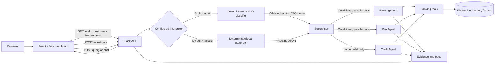

# Architecture

## Component diagram



## Request routing

1. The dashboard calls `/api/query` with `{"message": "..."}`. Direct transaction review uses `/api/investigate` with `{"transaction_id": "..."}`.
2. The configured interpreter defaults to local deterministic example matching. Gemini is attempted only when `GEMINI_ENABLED=true` and a key is present in `backend/.env`.
3. The interpreter extracts only an allowed intent and explicit identifier strings. Gemini JSON is checked against the intent allowlist, exact entity schema and ID formats; the supervisor still checks that the referenced fixture IDs exist and that customer/account ownership agrees.
4. Validation happens before agent instantiation/calls. Unknown or incomplete requests return clarification without agent calls. Invalid IDs and ownership mismatches return a clear error before agents execute.
5. The supervisor chooses the work:
   - `investigate_txn`: BankingAgent and RiskAgent run concurrently; CreditAgent is added for a sufficiently large debit.
   - `account_summary`: BankingAgent only.
   - `list_suspicious`: BankingAgent gathers histories and RiskAgent applies the rules concurrently across candidate transactions.
   - `explain_flag`: RiskAgent calculates the rule result if there is no cached result.
   - `unknown`: clarification only.
6. The supervisor returns the answer, structured data, evidence, risk explanation when applicable, interpreter label, and trace.

## Agent responsibilities

- **BankingAgent** obtains transaction/customer data, history, prior/registered payees, account totals, and loan fixture information using `BankingTools`. It assembles source-labelled evidence and does not infer fraud.
- **RiskAgent** calculates rule weights from transaction and customer-history inputs in Python. It does not call an LLM.
- **CreditAgent** returns available loan exposure and qualifying recent-loan-disbursal evidence. It does not infer intent or fraud.
- **Supervisor** validates request entities, routes by intent, coordinates parallel work, and builds the response. It does not calculate finance or risk itself.

## Deterministic risk calculation

The `RiskAgent` adds the weights of the triggered rules and caps the total at 100:

| Rule | Weight | Trigger |
|---|---:|---|
| `unusually_large_amount` | 35 | Debit is at least 100,000 cents |
| `new_payee` | 25 | Payee is not in registered/prior known payees for that customer |
| `unusual_hour` | 15 | Timestamp is between 00:00 and 04:59 UTC |
| `transaction_velocity` | 25 | Four or more customer transactions occur within 15 minutes of the selected transaction |

A score of 25 or above is included in the suspicious-list result and normally receives `Review required`. This score is a fixture-based prioritization aid, not a fraud finding; loan-disbursal evidence can also prompt review.

## Optional interpreter and fallback

The local interpreter is the guaranteed default. Gemini can only classify an intent and extract user-supplied identifiers. It receives no customer fixture, transaction history, account totals, or agent output. Its response is parsed and validated locally; invalid intent/entity schemas and missing mandatory identifiers are rejected. Missing key, disabled switch, API/quota errors, timeout, malformed JSON, and validation failures select the local interpreter. Responses carry `interpreter: "local"` or `"gemini"` and, when applicable, a non-sensitive `fallback_reason`.

Gemini configuration is read from `backend/.env` only. `backend/.env.example` contains no credential. The request uses the Gemini Interactions API with `store: false`; external provider terms and availability still apply.

## Validation and trace format

Transaction/customer/account existence and customer ownership are checked before agent creation and execution. An invalid identifier produces a validation error trace with zero agent/tool entries.

Tool traces contain:

```json
{
  "agent": "BankingAgent",
  "tool": "get_transaction_details",
  "input": {"transaction_id": "T-1042"},
  "output": {"transaction_id": "T-1042"},
  "duration_ms": 0.2,
  "status": "success"
}
```

Agent-level supervisor trace entries include `type: "agent"`, `agent`, `input`, `output`, `duration_ms`, and `status`. Routing entries identify the intent, chosen agent plan, and reason. Errors are explicitly represented with failed status and safe details. API keys are never part of tool inputs, routing responses, or traces.
